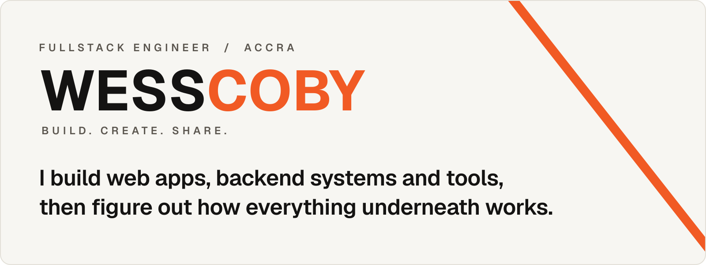

<picture>
  <source media="(prefers-color-scheme: dark)" srcset="assets/header-dark.svg">
  
</picture>

I'm Emmanuel Sekyere, a fullstack engineer in Accra. Most of what I write is TypeScript: NestJS and GraphQL on the server, React on the client. When a tool annoys me often enough, I write a smaller one that doesn't. Lately the curiosity runs further down the stack, into the containers, networks and machines the apps actually sit on.

**Now:** building Investment Nerds, a Ghana Stock Exchange investing platform that's in beta testing.

### What I work with

**Languages:** `TypeScript` `JavaScript` `Python`

**Backend:** `Node.js` `NestJS` `GraphQL` `Socket.IO` `Better Auth`

**Frontend:** `React` `Next.js` `React Native` `Redux Toolkit` `Tailwind CSS` `shadcn/ui`

**Data:** `PostgreSQL` `Prisma` `MySQL` `MongoDB` `Redis`

**Infra:** `Docker` `Forgejo` `Dokploy`

**Tools:** `git` `zsh` `tmux` `VS Code`

### Homelab

Wanting to know what sits behind the API is how a web developer ends up with a homelab. Everything I ship runs on infrastructure I own: Forgejo for Git, Dokploy for deploys, and my own S3, mail and analytics. Nobody asked me to run any of this. It started as curiosity, it became a hobby, and it's still what keeps me building.

### Writing

I write up what I learn at [wesscoby.com/blog](https://wesscoby.com/blog).

<!-- BLOG-POST-LIST:START -->
- [A Reason I Could Say Out Loud](https://wesscoby.com/blog/a-reason-i-could-say-out-loud)
- [The Second Test Suite](https://wesscoby.com/blog/the-second-test-suite)
<!-- BLOG-POST-LIST:END -->

### Quote of the moment

<a href="https://qotm.dev">
  <picture>
    <source media="(prefers-color-scheme: dark)" srcset="https://qotm.dev/today.svg">
    
  </picture>
</a>

### Activity

<picture>
  <source media="(prefers-color-scheme: dark)" srcset="https://rms.wesscoby.com/api?username=wesscoby&show_icons=true&count_private=true&hide_border=false&border_radius=8&bg_color=121110&title_color=F7F6F2&text_color=A39D94&icon_color=A39D94&ring_color=F15A24&border_color=2E2B28">
  
</picture>
<picture>
  <source media="(prefers-color-scheme: dark)" srcset="https://rms.wesscoby.com/api/top-langs/?username=wesscoby&hide=css,html&layout=compact&langs_count=8&hide_border=false&border_radius=8&bg_color=121110&title_color=F7F6F2&text_color=A39D94&border_color=2E2B28">
  
</picture>

### Elsewhere

[wesscoby.com](https://wesscoby.com) · [Blog](https://wesscoby.com/blog) · [X](https://x.com/wesscoby) · [LinkedIn](https://linkedin.com/in/wesscoby)
